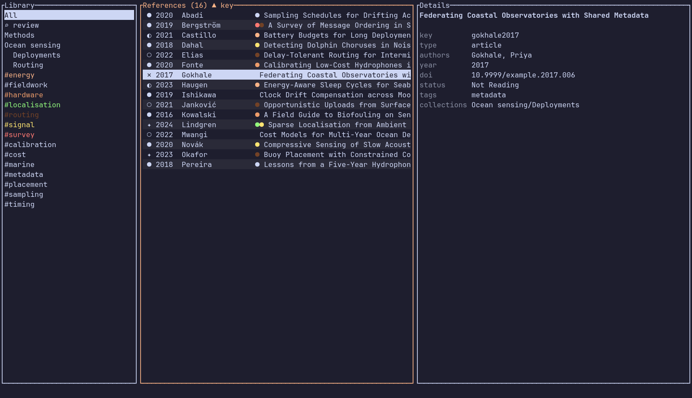
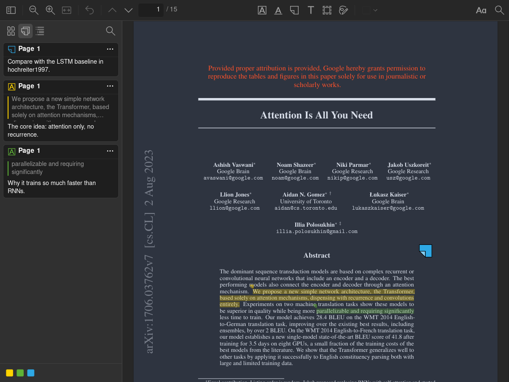
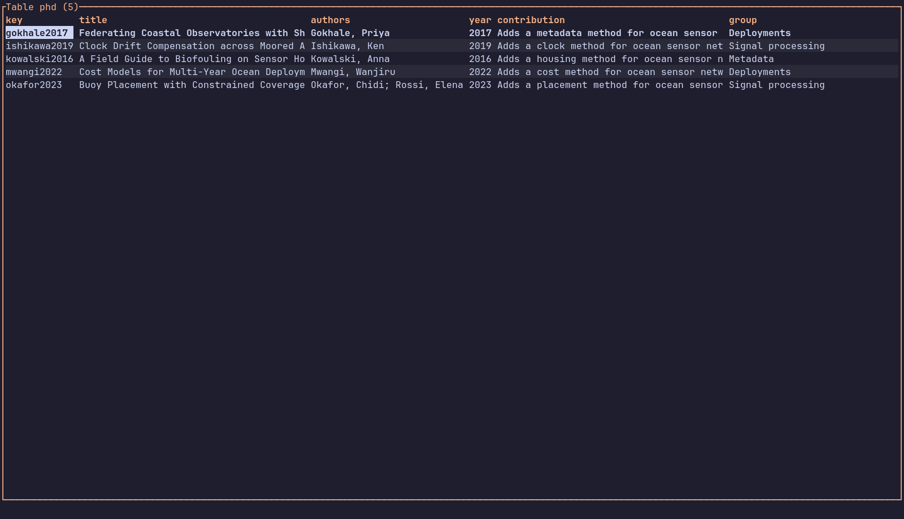
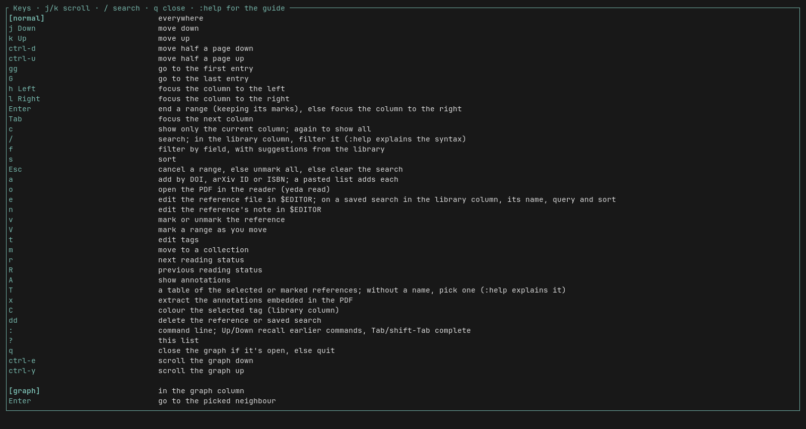

# yeda

<!-- The yeda-tui and yeda-android parts are copied from their READMEs by scripts/readme.py; edit those instead. -->
<!-- yeda-tui -->
**tl;dr:** a (vibe-coded) terminal reference manager whose library you can check into git, with a PDF reader built on Zotero's (so Zotero annotations carry over), citation graphs (including discovery of papers not in the library), a download assistant that makes fetching PDFs easy, LLM features such as paper discovery and summary tables, and an e-ink friendly companion Android app.

**🤖💩 All of yeda's code and documentation is written by AI (Claude). This is 100% vibe-coded 💩🤖**

I used [Zotero](https://www.zotero.org/), but wanted a reference manager in the terminal with vim keys. I tried every terminal reference manager I could find and didn't like any of them. I also really like [Local Citation Network](https://localcitationnetwork.github.io/), and wanted features like it built into my reference manager. So ~~I~~ Claude made yeda.

## About

yeda is a reference manager for the terminal, and an alternative to Zotero. Your library is a folder of plain TOML and Markdown files that works with git and Syncthing; PDFs live in a local or WebDAV folder.

From one terminal window, with vim keys, you can:
- add references by DOI, arXiv ID or ISBN, type them in (`:new`), or import your whole Zotero library;
- organize them with collections, tags, reading status, search and saved searches;
- read and annotate PDFs in the built-in reader, a modified version of Zotero's PDF reader that supports Zotero annotations, and keep Markdown notes;
- find PDFs, open access or through your library's proxy;
- explore citation graphs of what a paper cites and what cites it;
- compare papers in literature tables an LLM fills in, and find related papers;
- cite as BibTeX or in a citation style.

An Android app reads and annotates the same library.

## Dependencies

yeda runs on Linux only; macOS and Windows have no secret store backend yet ([#292](https://github.com/yuvve/yeda/issues/292)).

To build it:
- Rust;
- the system libraries of [Tauri's prerequisites](https://v2.tauri.app/start/prerequisites/).

To run it:
- WebKitGTK 4.1, for the PDF reader;
- poppler (`pdftotext`, `pdftoppm`), for full-text search, annotation extraction and summaries;
- a running Secret Service provider (GNOME Keyring, KWallet or KeePassXC) to save passwords and API keys;
- git, for `:sync`;
- glibc 2.34 or later, for the release binary.

## Usage

```sh
cargo install yeda
```

Or download the binary from the [latest release](https://github.com/yuvve/yeda/releases/latest). The binary is `yeda`.

```sh
yeda init       # once: create a library
yeda import     # or instead of init: create it from Zotero
yeda            # open it
```

`yeda <library dir>` opens a specific library. Without one, yeda opens the current folder if it is a library, else the default library.

> **Inside yeda, press `?` for every key and command, and type `:help` for the full guide.**

## Getting started

`yeda init` creates an empty library. A form asks for its folder, where its PDFs go (a local folder, a WebDAV folder, or none yet), and whether it becomes the default library. The library is ready for git and Syncthing.

`yeda import` creates a library from Zotero's; run it instead of `yeda init`. The same form also asks for Zotero's data folder. It imports the items, annotations, notes, tag colours and saved searches, and copies every PDF to the chosen place, whether Zotero stored it, linked it, or only has it on its WebDAV server. Zotero can stay open; it is only read.

## Main window



- **Library**: pick a collection, tag or saved search to filter the list.
- **References**: your papers, with their reading status (✦ new, ○ to read, ◐ in progress, ● read; `r` changes it) and a dot per coloured tag. `/` searches, `s` sorts, `v` marks papers to act on together.
- **Right column**: details of the selected paper by default; `:graph`, `A` (annotations) and `T` (table) show something else there.
- **Bottom line**: messages, and what you type after `:` or `/`.

`h`/`l` or `Tab` move between columns, `j`/`k` move within one, and `c` shows the current column alone. A narrow terminal hides the right column, then the library.

Every other row of the reference list and of a literature table is shaded a little lighter than the terminal's own background, so a line is easy to follow across the window. A terminal that does not report its background gets plain rows.

## Reading and annotating

`o` opens the selected paper's PDF in yeda's reader, which you control with vim keys. There you highlight, underline, and add notes, text, image areas and ink. Annotations are saved in the library, next to the paper, so the Android app shows them too. `A` lists them in the right column. In the reader, `og` and `ag` open a fuzzy-searchable list of the PDF's sections and annotations to jump to, and `?` a fuzzy-searchable list of all the reader's keys.

Column mode (`C`, or the two-columns button in the reader's toolbar) reads a two-column paper one column at a time, each as wide as the window, a screen per page turn. The button next to it sets where the columns are, by dragging a crop box and the gutter over the page; a new paper starts with the last ones set.



## Settings

`~/.config/yeda/config.toml` holds this device's settings; yeda creates it with them commented out:

```toml
library = "~/yeda"               # the default library
reader = "default"               # yeda's own PDF reader

[locations]                      # this device's folder for a location
pdfs = "/mnt/papers"
```

`reader` can name another command, run as `<command> <pdf> --annotations <dir>`. yeda then sees only the annotations that reader saves in the PDF, through `x`.

`:setup` lists what it sets (LLM providers and profiles, WebDAV locations, the OpenAlex key, web search, library proxies, tables) as they are now; `Enter` opens one's form. `:config` opens yeda.toml in `$EDITOR`, `:config device` this device's config.toml.

## Graphs

`:graph` draws a citation graph of the selected paper, or of the marked ones (`v`, `V`). Rows are years, newest at the top:


- ⊚ the papers you graphed, ◎ other library papers linked to them, ○ papers outside the library cited by or citing them most
- yellow lines go to papers the selected one cites, magenta lines come from papers citing it

In the graph, `Enter` opens a paper and grows the graph from it, and `a` adds it to the library.

`:graph tags` and `:graph col <column>` group papers by their tags or by a literature table column instead. Data comes from OpenAlex and is cached. `:help` has the full guide.

## LLM features

Both features below use an LLM profile from the library's `yeda.toml`. A profile names a provider and a model; the provider holds where to connect and how:

```toml
default_llm = "claude"

[providers.claude]
base_url = "https://api.anthropic.com"
protocol = "anthropic"            # or "openai", "mistral", "openrouter", "opencode-go", "openai-responses"
auth = "oauth"                    # or "api-key", or "none" for a server without a key

[llm.claude]
provider = "claude"
model = "claude-opus-5-5"
```

Use `:setup provider` to set up a provider and its credential, then `:setup llm` to add profiles that name a provider and a model. Profiles bound to one provider share its credential.

A command uses `default_llm` unless it names another profile: `:discover --llm gpt swarm robots`.

### Literature tables

A literature table compares papers side by side: one row per paper, one column per question you ask of every paper. `:setup table` defines its columns, each with an optional description of what it should hold; in `yeda.toml` they look like this:

```toml
[tables.lit]
columns = ["contribution", "group", "subproblem"]

[tables.lit.describe]
contribution = "What the paper adds, in plain words; no jargon."
group = "The topic it works on: a short label many papers share."
subproblem = "The problem it tackles and why earlier work falls short."
```

`:summarize` has the LLM read each selected paper and fill in its row. The LLM also sees the values other papers already have in each column and reuses one when it fits, so a column like `group` sorts papers into shared topics.

`:table` shows the rows of the selected papers. Cells can be read in full, edited, sorted and filtered; `:export` writes the table to CSV, `yeda import-table` reads one back, and `:graph col group` clusters papers by a column's values.



### Finding papers

`:discover` asks the LLM for papers related to the selected ones, or to a description you give (`:discover swarm exploration under comms loss`). The model writes several queries; yeda searches the enabled web providers and arXiv in parallel, matches the hits to OpenAlex works, drops what is not a paper, and has the model rank the rest. `:setup web-search` chooses the providers (`keenable`, `exa`, `parallel`, `firecrawl`, `searxng`, or the LLM provider's own search) and their optional keys; arXiv is always searched. `:discover!` skips cached results. Marked papers are kept and sorted last, `v` marks, and `a` adds.

```toml
[web_search]
always_search_providers   = ["keenable"]
fallback_search_providers = ["exa", "parallel", "firecrawl"]
disabled_search_providers = ["model_provider_web_search", "searxng"]
discover_queries          = 3        # queries the model writes per :discover
discover_results          = 15       # papers shown
# searxng_url             = "https://searx.example.org"
```

Fallbacks run only if every "always" provider fails. Without an API key a provider uses its shared free tier; keyed and keyless calls may use different endpoints. Results are cached in `$XDG_CACHE_HOME/yeda`. `yeda.toml` is trusted like code, so a changed `searxng_url` sends queries elsewhere.

## Secrets

When a password or API key is missing, yeda asks for it and offers to save it in the secret store; `:secrets` lists and changes them. LLM profiles bound to the same provider share one API key or OAuth credentials. Web search provider keys are optional and only used by `:discover`. Keys are stored with their server's address, so a key is only sent to the server it was entered for. Passwords, API keys and tokens only go to `https://` servers, local ones included: LLM servers, WebDAV locations, web search providers and library proxies with a plain `http://` address are refused.

An environment variable overrides the secret store: `YEDA_KEY_<HOST>_<PORT>`, or `YEDA_DAV_<HOST>_<PORT>` for WebDAV, with `.` as `_` and `-` as `__` (`https://api.anthropic.com` is `YEDA_KEY_API_ANTHROPIC_COM_443`). Give providers or WebDAV locations on the same server an `alias`, and `…_ALIAS_<ALIAS>` is theirs alone. `:secrets` shows where each secret comes from, `:envvars` the variable names and which secrets need an alias.

## Keys and commands



Every key runs a command, and every action is a command (`:annotations` is the same as `A`). Options go anywhere in a command as `--name value`, and `--` ends them. `?` lists the keys and commands in effect; `:help` is the guide to searching, tables, graphs, fetching and the reader. Keys are rebound in `config.toml` under `[keys.<context>]`:

```toml
[keys.normal]
"F" = "cite ieee"
"x" = ""                         # unbinds x
```

## Scripting

yeda is used through its TUI, but most commands can also run without it, for scripts and agents. Each subcommand takes references by key (or `-` to read keys from stdin), and prints keys or tab-separated lines (`--json` gives more):

```sh
yeda search tag:review --sort -year               # key, year, authors, title
yeda search coll:thesis | yeda cite - --format apa
yeda add 10.1038/nature14539 --to thesis
yeda graph lecun2015 > graph.json
yeda discover "swarm exploration under comms loss" --json   # queries and notes go to stderr
```

`yeda help` lists them all. They use the library's settings and the secrets saved from the TUI.
<!-- /yeda-tui -->

## Android app

<!-- yeda-android -->
The Android app is for reading and annotating your library on a phone or tablet. Adding references, citation graphs, literature tables, finding PDFs and citing stay in the terminal app. The interface is high-contrast and has no animations, so it suits e-ink screens.

Install the APK from the [latest release](https://github.com/yuvve/yeda/releases/latest). Pre-releases are betas.

<p>
  
  
  
  
</p>

### Getting started

On first start, pick the library folder with the system folder picker and allow all-files access. To get a library onto the device, sync its folder with Syncthing, or clone its git repository from Settings into an empty folder. When a PDF location's folder isn't found on the device, the app asks for it once.

### Main window

- **All ▾**: pick a collection, tag or saved search.
- **Search**: the same search as the terminal app, such as `author:smith tag:ml`; a search can be saved.
- **Filter**: a form for searching by field. **▲ key** sorts.
- **⟳**: git sync. **⚙**: settings.

Every other row of the list is shaded, so a line is easy to follow across the screen.

Tap a paper to open it. There you open its PDFs or add one, preview its annotations, edit its Markdown note or its raw file, and change its reading status, tags and collection.

### Reading and annotating

The reader is the same as on the desktop: a modified version of Zotero's PDF reader, so Zotero annotations show and can be edited. Once a pen has been used, the pen draws and a finger pans (two fingers zoom), a resting palm is ignored, and the pen's side button or eraser end erases. Settings → Display → E-ink screen shows one page at a time, turned by swiping, with black ink. The two-columns button reads a two-column paper one column at a time, each as wide as the screen; swiping steps down the column and on to the next. The button next to it sets where the columns are, by dragging a crop box and the gutter over the page.

PDFs from outside the library open with "Open with"; their annotations go in a `<file>.annotations/` folder next to the PDF.

### Sync

⟳ commits everything, merges `origin`'s branch of the same name and pushes, over HTTPS. Conflicting annotation files are merged annotation by annotation; any other conflict stops the sync.

### Settings

Settings → WebDAV location adds a WebDAV folder for PDFs after a test login. Settings can also be edited as text: the library folder, and `[locations]` for folders on this device. Passwords and tokens are kept in the Android Keystore.

The app icon is from Flaticon: [Knowledge graph icons created by Jagat Icon - Flaticon](https://www.flaticon.com/free-icons/knowledge-graph).
<!-- /yeda-android -->

## The library

```
<library>/
  yeda.toml                               # settings shared by every device
  refs/<citekey>.toml                     # one reference each
  notes/<citekey>.md                      # your notes
  notes/<citekey>.ai.toml                 # what an LLM wrote for the tables
  annotations/<citekey>/<pdf>/annotations.toml  # annotations on one PDF
  annotations/<citekey>/<pdf>/img/<id>.png      # image and ink annotations
```

PDFs are kept outside the library folder, in *locations*: local folders or WebDAV folders, each holding `<citekey>/<file>`. WebDAV PDFs are cached locally. A reference can have several PDFs, each a `[[pdf]]` entry whose `id` names its annotations folder.

### Shared settings

`yeda.toml` holds what every device shares, such as the locations and saved searches:

```toml
[locations]
pdfs = "~/yeda-pdfs"             # a local folder
dav = { url = "https://dav.example.com/yeda/", user = "me" }

[searches]
"To read" = { query = 'status:"^To Read$"', sort = "year", descending = true }
```

Each device also has its own config, which may give a location a different folder on that device: `~/.config/yeda/config.toml` on the desktop, the app's settings on Android.

All passwords and API keys are kept in the system secret store.

`yeda.toml` is trusted like code: whoever can write to the library's git remote or Syncthing folder decides which servers get LLM requests, which proxies the fetch window logs in to, and which WebDAV servers hold the PDFs. What they cannot get is a secret: each is stored with its server's address, so a changed address finds none and yeda asks for one, naming the server; read that name before answering. The status line also names the server of every LLM request and the proxies before the fetch window opens, and the log keeps those lines.

The PDF URLs in `[fulltext.patterns]` come from `yeda.toml` too, and the open-access ones from OpenAlex. A direct download goes only over `https://` (a plain `http://` URL is tried as `https://`) and only to a public host, after each of at most 5 redirects as well: `localhost`, dotless names, `.local` names and private, loopback and link-local addresses are refused. A name whose DNS points at a private address is not caught. A download stops at 100 MB.

## Building

```sh
git clone --recursive <this repo>
cargo install --path yeda-tui      # the `yeda` binary, with the reader built in
```

`scripts/test-library.sh` copies `testdata/library`, a library of real papers, to a scratch folder and fetches its open-access PDFs, for trying changes without touching your own library.
