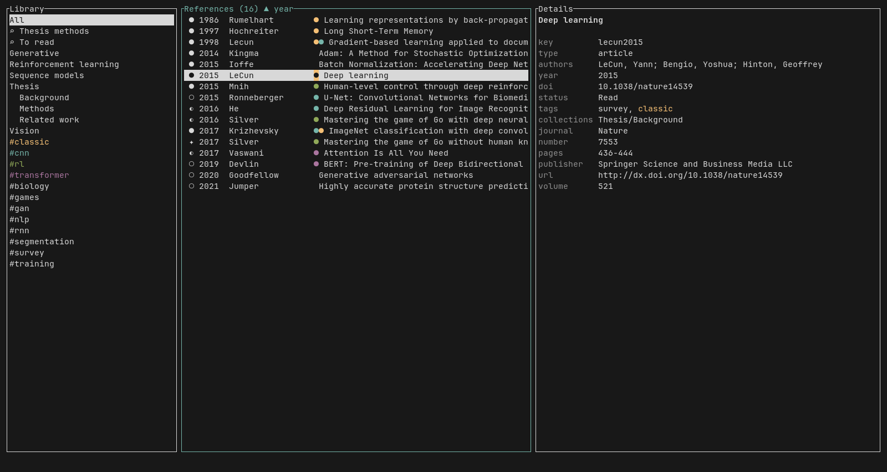
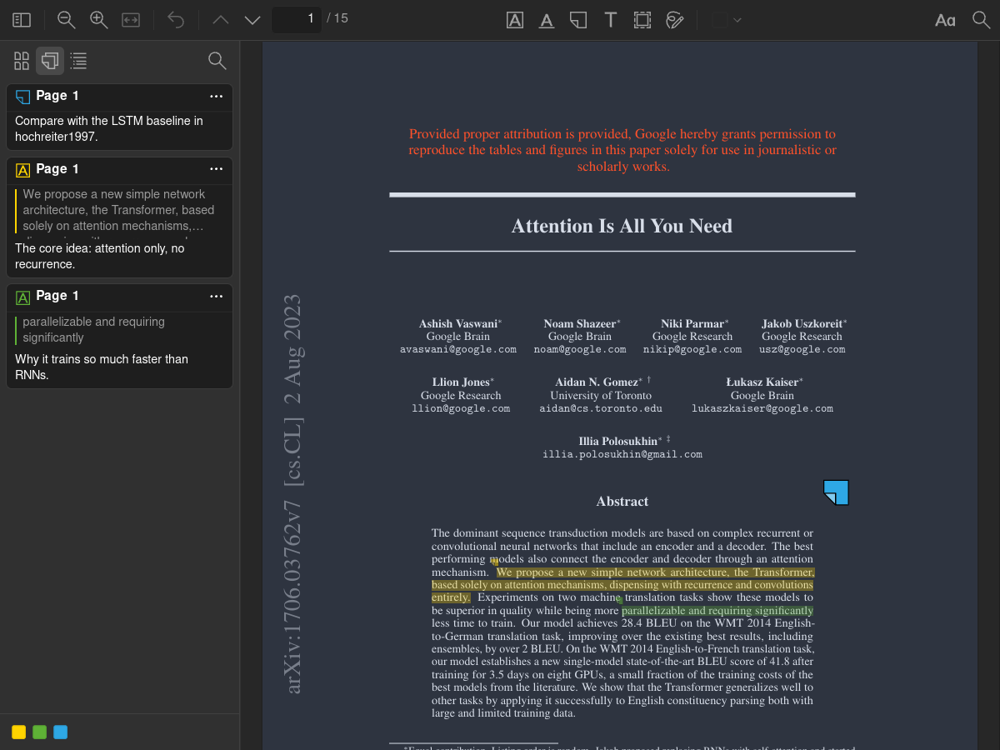
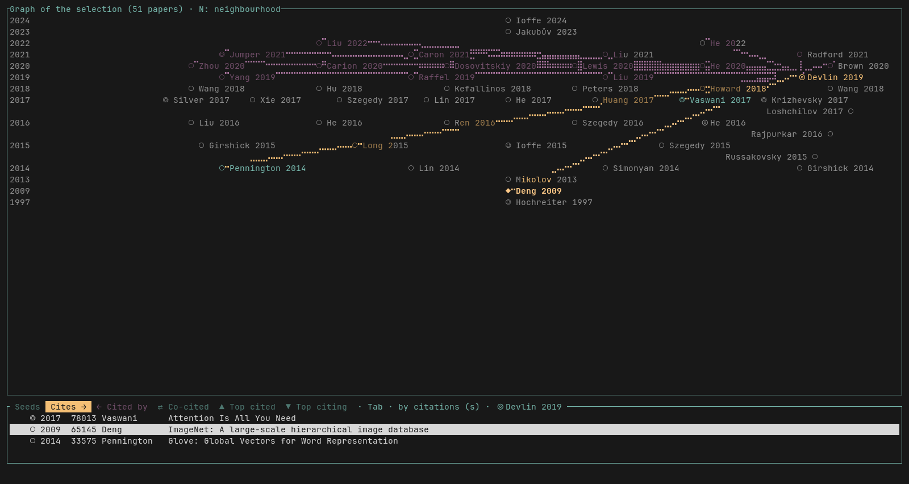
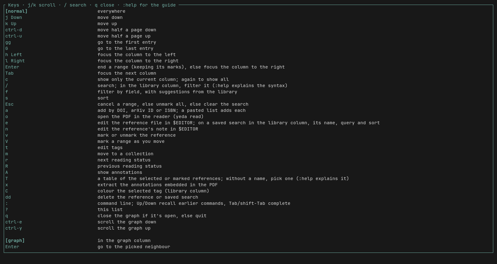
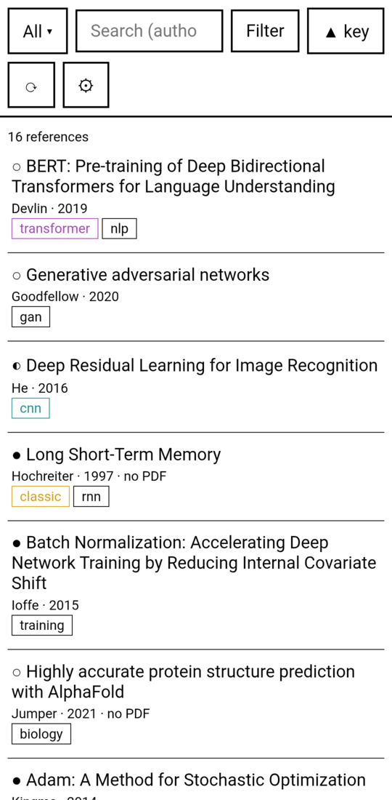
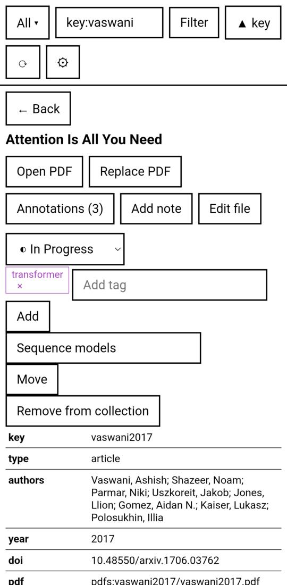
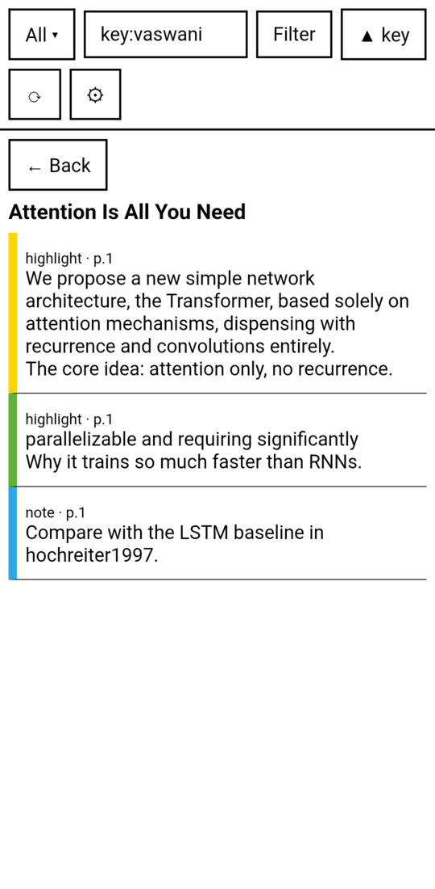
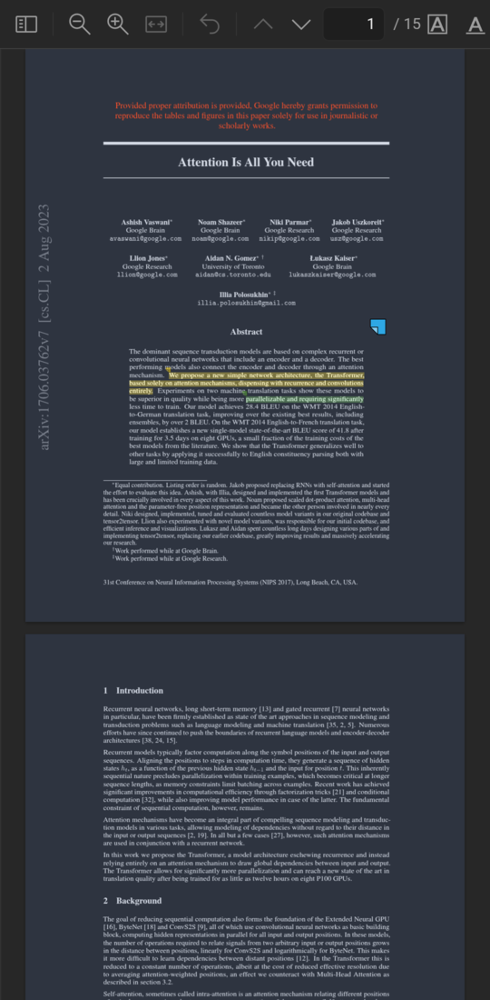

# yeda

<!-- The yeda-tui and yeda-android parts are copied from their READMEs by scripts/readme.py; edit those instead. -->
<!-- yeda-tui -->
**tl;dr:** a (vibe-coded) terminal reference manager whose library you can check into git, with a PDF reader built on Zotero's (so Zotero annotations carry over), citation graphs (including discovery of papers not in the library), a download assistant that makes fetching PDFs easy, LLM features such as paper discovery and summary tables, and an e-ink friendly companion Android app.

**🤖💩 All of yeda's code and documentation is written by AI (Claude). This is 100% vibe-coded 💩🤖**

I used [Zotero](https://www.zotero.org/), but wanted a reference manager in the terminal with vim keys. I tried every terminal reference manager I could find and didn't like any of them. I also really like [Local Citation Network](https://localcitationnetwork.github.io/), and wanted features like it built into my reference manager. So ~~I~~ Claude made yeda.

## About

yeda is a reference manager for the terminal, and an alternative to Zotero. Your library is a folder of plain TOML and Markdown files that works with git and Syncthing; PDFs live in a local or WebDAV folder.

From one terminal window, with vim keys, you can:
- add references by DOI, arXiv ID or ISBN, or import your whole Zotero library;
- organize them with collections, tags, reading status, search and saved searches;
- read and annotate PDFs in the built-in reader, a modified version of Zotero's PDF reader that supports Zotero annotations, and keep Markdown notes;
- find PDFs, open access or through your library's proxy;
- explore citation graphs of what a paper cites and what cites it;
- compare papers in literature tables an LLM fills in, and find related papers;
- cite as BibTeX or in a citation style.

An Android app reads and annotates the same library.

## Usage

```sh
cargo install yeda
```

Building it needs the system libraries of [Tauri's prerequisites](https://v2.tauri.app/start/prerequisites/) (WebKitGTK on Linux), which the PDF reader uses. The binary is `yeda`.

```sh
yeda init       # once: create a library
yeda import     # or instead of init: create it from Zotero
yeda            # open it
```

`yeda <library dir>` opens a specific library. Without one, yeda opens the current folder if it is a library, else the default library.

> **Inside yeda, press `?` for every key and command, and type `:help` for the full guide.**

## Getting started

`yeda init` creates an empty library. A form asks for its folder, where its PDFs go (a local folder, a WebDAV folder, or none yet), and whether it becomes the default library. The library is ready for git and Syncthing.

`yeda import` creates a library from Zotero's; run it instead of `yeda init`. The same form also asks for Zotero's data folder. It imports the items, annotations, notes, tag colours and saved searches, and copies every PDF to the chosen place, whether Zotero stored it, linked it, or only has it on its WebDAV server. Zotero can stay open; it is only read.

## Main window



- **Library**: pick a collection, tag or saved search to filter the list.
- **References**: your papers, with their reading status (✦ new, ○ to read, ◐ in progress, ● read; `r` changes it) and a dot per coloured tag. `/` searches, `s` sorts, `v` marks papers to act on together.
- **Right column**: details of the selected paper by default; `:graph`, `A` (annotations) and `T` (table) show something else there.
- **Bottom line**: messages, and what you type after `:` or `/`.

`h`/`l` or `Tab` move between columns, `j`/`k` move within one, and `c` shows the current column alone. A narrow terminal hides the right column, then the library.

## Reading and annotating

`o` opens the selected paper's PDF in yeda's reader, which you control with vim keys. There you highlight, underline, and add notes, text, image areas and ink. Annotations are saved in the library, next to the paper, so the Android app shows them too. `A` lists them in the right column.

Column mode (`C`, or the two-columns button in the reader's toolbar) reads a two-column paper one column at a time, each as wide as the window, a screen per page turn. The button next to it sets where the columns are, by dragging a crop box and the gutter over the page; a new paper starts with the last ones set.



## Settings

`~/.config/yeda/config.toml` holds this device's settings; yeda creates it with them commented out:

```toml
library = "~/yeda"               # the default library
reader = "default"               # yeda's own PDF reader

[locations]                      # this device's folder for a location
pdfs = "/mnt/papers"
```

`reader` can name another command, run as `<command> <pdf> --annotations <dir>`. yeda then sees only the annotations that reader saves in the PDF, through `x`.

Extracting annotations from a PDF (`x`) needs poppler installed.

## Graphs

`:graph` draws a citation graph of the selected paper, or of the marked ones (`v`, `V`). Rows are years, newest at the top:



- ⊚ the papers you graphed, ◎ other library papers linked to them, ○ papers outside the library cited by or citing them most
- yellow lines go to papers the selected one cites, magenta lines come from papers citing it

In the graph, `Enter` opens a paper and grows the graph from it, and `a` adds it to the library.

`:graph tags` and `:graph col <column>` group papers by their tags or by a literature table column instead. Data comes from OpenAlex and is cached. `:help` has the full guide.

## LLM features

Both features below use an LLM profile from the library's `yeda.toml`; `:setup llm` writes one:

```toml
default_llm = "claude"

[llm.claude]
provider = "anthropic"           # or "openai" for any OpenAI-compatible server
model = "claude-opus-5-5"
```

### Literature tables

A literature table compares papers side by side: one row per paper, one column per question you ask of every paper. You define its columns in `yeda.toml`, each with an optional description of what it should hold:

```toml
[tables.lit]
columns = ["contribution", "group", "subproblem"]

[tables.lit.describe]
contribution = "What the paper adds, in plain words; no jargon."
group = "The topic it works on: a short label many papers share."
subproblem = "The problem it tackles and why earlier work falls short."
```

`:summarize` has the LLM read each selected paper and fill in its row. The LLM also sees the values other papers already have in each column and reuses one when it fits, so a column like `group` sorts papers into shared topics.

`:table` shows the rows of the selected papers. Cells can be read in full, edited, sorted and filtered; `:export` writes the table to CSV, `yeda import-table` reads one back, and `:graph col group` clusters papers by a column's values.

### Finding papers

`:discover` asks the LLM for papers related to the selected ones, or to a description you give (`:discover swarm exploration under comms loss`). An Anthropic profile searches the web for them. Each suggestion is looked up in OpenAlex, so you can see which ones exist and which are already in the library, and `a` adds one.

## Secrets

When a password or API key is missing, yeda asks for it and offers to save it in the secret store; `:secrets` lists and changes them. An LLM key is stored for its server's address, so a key is only sent to the server it was entered for.

## Keys and commands



Every key runs a command, and every action is a command (`:annotations` is the same as `A`). `?` lists the keys and commands in effect; `:help` is the guide to searching, tables, graphs, fetching and the reader. Keys are rebound in `config.toml` under `[keys.<context>]`:

```toml
[keys.normal]
"F" = "cite ieee"
"x" = ""                         # unbinds x
```
<!-- /yeda-tui -->

## Android app

<!-- yeda-android -->
The Android app is for reading and annotating your library on a phone or tablet. Adding references, citation graphs, literature tables, finding PDFs and citing stay in the terminal app. The interface is high-contrast and has no animations, so it suits e-ink screens.

Install the APK from the [releases](https://github.com/yuvve/yeda/releases).

<p>
  
  
  
  
</p>

### Getting started

On first start, pick the library folder with the system folder picker and allow all-files access. To get a library onto the device, sync its folder with Syncthing, or clone its git repository from Settings into an empty folder. When a PDF location's folder isn't found on the device, the app asks for it once.

### Main window

- **All ▾**: pick a collection, tag or saved search.
- **Search**: the same search as the terminal app, such as `author:smith tag:ml`; a search can be saved.
- **Filter**: a form for searching by field. **▲ key** sorts.
- **⟳**: git sync. **⚙**: settings.

Tap a paper to open it. There you open its PDFs or add one, preview its annotations, edit its Markdown note or its raw file, and change its reading status, tags and collection.

### Reading and annotating

The reader is the same as on the desktop: a modified version of Zotero's PDF reader, so Zotero annotations show and can be edited. Once a pen has been used, the pen draws and a finger pans (two fingers zoom), a resting palm is ignored, and the pen's side button or eraser end erases. Settings → Display → E-ink screen shows one page at a time, turned by swiping, with black ink. The two-columns button reads a two-column paper one column at a time, each as wide as the screen; swiping steps down the column and on to the next. The button next to it sets where the columns are, by dragging a crop box and the gutter over the page.

PDFs from outside the library open with "Open with"; their annotations go in a `<file>.annotations/` folder next to the PDF.

### Sync

⟳ commits everything, merges `origin`'s branch of the same name and pushes, over HTTPS. Conflicting annotation files are merged annotation by annotation; any other conflict stops the sync.

### Settings

Settings → WebDAV location adds a WebDAV folder for PDFs after a test login. Settings can also be edited as text: the library folder, and `[locations]` for folders on this device. Passwords and tokens are kept in the Android Keystore.

The app icon is from Flaticon: [Knowledge graph icons created by Jagat Icon - Flaticon](https://www.flaticon.com/free-icons/knowledge-graph).
<!-- /yeda-android -->

## The library

```
<library>/
  yeda.toml                               # settings shared by every device
  refs/<citekey>.toml                     # one reference each
  notes/<citekey>.md                      # your notes
  notes/<citekey>.ai.toml                 # what an LLM wrote for the tables
  annotations/<citekey>/<pdf>/annotations.toml  # annotations on one PDF
  annotations/<citekey>/<pdf>/img/<id>.png      # image and ink annotations
```

PDFs are kept outside the library folder, in *locations*: local folders or WebDAV folders, each holding `<citekey>/<file>`. WebDAV PDFs are cached locally. A reference can have several PDFs, each a `[[pdf]]` entry whose `id` names its annotations folder.

### Shared settings

`yeda.toml` holds what every device shares, such as the locations and saved searches:

```toml
[locations]
pdfs = "~/yeda-pdfs"             # a local folder
dav = { url = "https://dav.example.com/yeda/", user = "me" }

[searches]
"To read" = { query = 'status:"^To Read$"', sort = "year", descending = true }
```

Each device also has its own config, which may give a location a different folder on that device: `~/.config/yeda/config.toml` on the desktop, the app's settings on Android.

All passwords and API keys are kept in the system secret store.

## Building

```sh
git clone --recursive <this repo>
cargo install --path yeda-tui      # the `yeda` binary, with the reader built in
```
