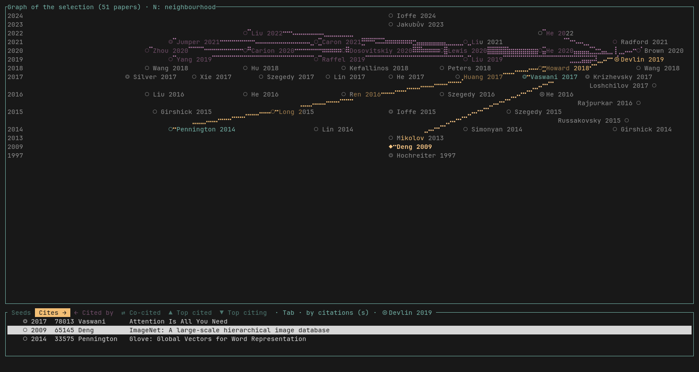
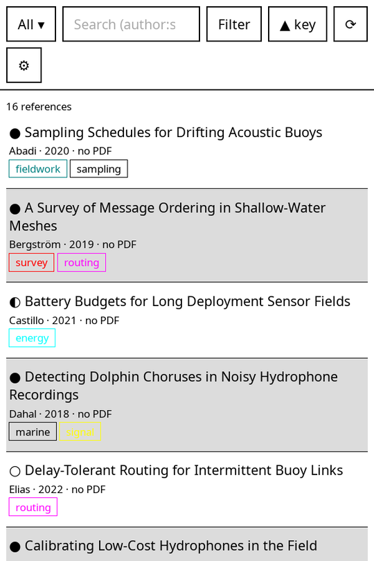
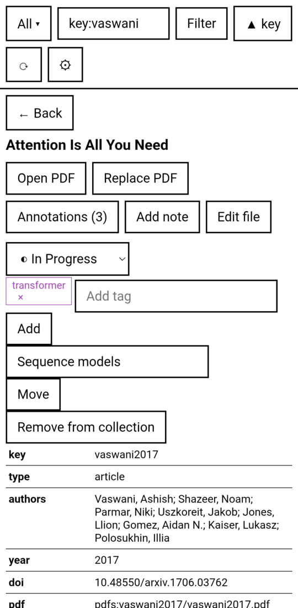
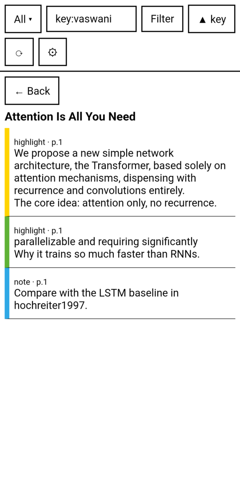

# yeda

<!-- The yeda-tui and yeda-android parts are copied from their READMEs by scripts/readme.py; edit those instead. -->
<!-- yeda-tui -->
yeda is a vibe-coded, Git- and Markdown-first terminal reference manager with Vim-style keys, dotfile-friendly configuration, and plenty of quality-of-life features for discovering and exploring papers, fetching and annotating PDFs, generating LLM summaries, and more.

## About

yeda is a reference manager for the terminal, and an alternative to Zotero. Your library is a folder of plain TOML and Markdown files that works with git and Syncthing; PDFs live in a local folder, on WebDAV or in Dropbox. An Android app reads and annotates the same library.


- **Collect:** add references by DOI, arXiv ID or ISBN (`:add`), by hand (`:new`), or from Zotero (`yeda import`).
- **Organize:** collections, tags, reading status, search and saved searches.
- **Read:** a PDF reader based on Zotero's, with Zotero-compatible annotations and Markdown notes.
- **Fetch:** find PDFs, open access or through your library's proxy (`:fetch`).
- **Explore:** citation graphs of what a paper cites and what cites it (`:graph`).
- **Compare:** literature tables an LLM fills in (`:summarize`, `:table`).
- **Discover:** related papers from the web and arXiv (`:discover`).
- **Cite:** BibTeX or a citation style (`:cite`).
- **Sync:** the library through git (`:sync`).

## Dependencies

yeda runs on Linux only; macOS and Windows have no secret store backend yet ([#292](https://github.com/yuvve/yeda/issues/292)).

- To build: Rust and [Tauri's prerequisites](https://v2.tauri.app/start/prerequisites/).
- To run: WebKitGTK 4.1 (the reader), poppler (full-text search, annotation extraction, summaries), git (sync), a Secret Service provider such as GNOME Keyring, KWallet or KeePassXC (passwords and API keys), and glibc 2.34 or later for the release binary.

## Usage

```sh
cargo install yeda    # or download the binary from the latest release
yeda init             # create a library
yeda import           # or create it from Zotero
yeda                  # open it
```

`yeda <library dir>` opens a specific library. Without one, yeda opens the current folder if it is a library, else the default library.

`yeda import` takes Zotero's items, annotations, notes, tag colours and saved searches, and copies every PDF to the chosen place. Zotero can stay open; it is only read.

## Keys and commands

Every action is a command with a key, rebindable in `config.toml`. [All keys and commands](yeda-tui/KEYS.md), and [the reader's keys](yeda-tui/../yeda-reader/KEYS.md). Inside yeda, `?` lists them and `:help` is the guide.

## Reader


Highlights, underlines, notes, text, image areas and ink, saved in the library next to the paper, so the Android app shows them too. Column mode reads two-column papers one column at a time. `reader` in `config.toml` can name another PDF reader, which yeda then sees only through the annotations it saves in the PDF.

## Graphs



`:graph` draws the citation graph of the selected or marked papers by year, from OpenAlex. Papers outside the library can be added from it. `:graph tags` and `:graph col <column>` cluster papers by tags or by a table column.

## LLM features

LLM features use a profile from `yeda.toml`: a provider and a model. `:setup provider` and `:setup llm` add them.

A provider is a preset (`anthropic`, `codex`, `opencode-go`, `openrouter`) or set by hand: a `protocol` (`chat-completions`, `responses` or `messages`), a `base_url` and an `auth` (`api-key` or `none`). `codex` signs in with a ChatGPT plan. `:help providers` and [PROVIDERS.md](yeda-core/PROVIDERS.md) show every preset as config; to change one, copy its table under a name of your own and edit it. If a preset breaks, fix your copy and send the working table as a pull request. A provider set by hand can add `headers`, which take `{app}`, `{version}`, `{repository}`, `{install}`, `{session}` (one per command) and `{request}`.

A profile can set `documents` (`file`, or `text` for a model that takes no PDF), `structured_output` (`json-schema`, `json-object` or `prompt`), `reasoning_effort`, `max_output_tokens` and `body`. Each command ends with the tokens it used, and the cost when the provider reports it.

```toml
default_llm = "claude"

[providers.claude]
preset = "anthropic"

[providers.lan]
protocol = "chat-completions"
base_url = "https://llm.lan/v1"
auth = "none"

[llm.claude]
provider = "claude"
model = "claude-opus-5-5"

[llm.local]
provider = "lan"
model = "qwen3"
documents = "text"
```

### Literature tables

One row per paper, one column per question, filled in by the LLM (`:summarize`). Columns come from `:setup table`; the LLM reuses values other papers already have, so a column like `group` sorts papers into shared topics. Tables export to CSV (`:export`) and import back (`yeda import-table`).


### Finding papers

`:discover` takes a description, or the marked papers as examples, and has the LLM search the web and arXiv and rank the results. Search providers are set with `:setup web-search`.

### Running commands from a request

`:do` has the LLM turn a request, such as "add this DOI to a collection called PhD and fetch its pdf", into yeda commands. You approve the plan before it runs, and one undo takes all of it back. A plan can only use `:add`, `:fetch`, `:summarize`, `:discover`, `:search`, `:cache`, `:extract`, `:cite`, `:table`, `:graph`, `:export`, `:save` and `:sync`. The request, the names of collections, tags, tables and locations, and the titles of the marked (else selected) references go to the LLM server.

## Secrets

Passwords and API keys live in the system secret store (`:secrets`), each tied to its server's address, so a key is only sent to the server it was entered for. Secrets only go to `https://` servers. Environment variables can replace or override the secret store (`:envvars`). A SearXNG instance behind basic auth takes its user name and password through `:setup web-search searxng`, in the secret store, never in the URL.

## Scripting

Most commands also run without the TUI. A subcommand takes references by key (or `-` for keys from stdin) and prints keys or tab-separated lines (`--json` gives more):

```sh
yeda search tag:review --sort -year               # key, year, authors, title
yeda search coll:thesis | yeda cite - --format apa
yeda add 10.1038/nature14539 --to thesis
yeda graph lecun2015 > graph.json
yeda discover "swarm exploration under comms loss" --json   # queries and notes go to stderr
```
<!-- /yeda-tui -->

## Android app

<!-- yeda-android -->
The Android app is for reading and annotating your library on a phone or tablet. Adding references, citation graphs, literature tables, finding PDFs and citing stay in the terminal app. The interface is high-contrast and has no animations, so it suits e-ink screens.

Install the APK from the [latest release](https://github.com/yuvve/yeda/releases/latest). Pre-releases are betas.

<p>
  
  
  
  
</p>

### Getting started

On first start, pick the library folder and allow all-files access. Get a library onto the device by syncing its folder with Syncthing, or by cloning its git repository from the settings. When a PDF location's folder isn't found on the device, the app asks for it once.

### Features

- **Browse:** filter by collection, tag or saved search; search with the terminal app's syntax; sort.
- **Paper page:** open or add PDFs, preview annotations, edit the Markdown note, change status, tags and collection.
- **Reader:** the same as on the desktop, with Zotero-compatible annotations, column mode and a pen mode (the pen draws, a finger pans, a palm is ignored). An e-ink mode (Settings → Display → E-ink screen) shows one page at a time, turned by swiping, with black ink.
- **Open with:** PDFs from outside the library open with their annotations in a `<file>.annotations/` folder.
- **Sync:** commits, merges `origin` and pushes over HTTPS. Conflicting annotation files are merged annotation by annotation; any other conflict stops the sync.
- **PDFs:** from local folders, WebDAV or Dropbox. Passwords and tokens are kept in the Android Keystore.

The app icon is from Flaticon: [Knowledge graph icons created by Jagat Icon - Flaticon](https://www.flaticon.com/free-icons/knowledge-graph).
<!-- /yeda-android -->

## The library

```
<library>/
  yeda.toml                               # settings shared by every device
  refs/<citekey>.toml                     # one reference each
  notes/<citekey>.md                      # your notes
  notes/<citekey>.ai.toml                 # what an LLM wrote for the tables
  annotations/<citekey>/<pdf>/annotations.toml  # annotations on one PDF
  annotations/<citekey>/<pdf>/img/<id>.png      # image and ink annotations
```

PDFs are kept outside the library folder, in *locations*: a local folder, a WebDAV folder or Dropbox, each holding `<citekey>/<file>`. Remote PDFs are cached locally. `:setup storage` adds a location; `:help` has the steps for using your own Dropbox app. A reference can have several PDFs, each a `[[pdf]]` entry whose `id` names its annotations folder.

### Shared settings

`yeda.toml` holds what every device shares, such as the locations and saved searches:

```toml
[locations]
pdfs = { kind = "local", path = "~/yeda-pdfs" }
dav = { kind = "webdav", url = "https://dav.example.com/yeda/", user = "me" }
box = { kind = "dropbox", folder = "pdfs" }

[searches]
"To read" = { query = 'status:"^To Read$"', sort = "year", descending = true }
```

Each device also has its own config, whose `[locations]` may give a location a different folder on that device: `~/.config/yeda/config.toml` on the desktop, the app's settings on Android.

### Trust

`yeda.toml` is trusted like code: whoever can write to the library's git remote or Syncthing folder decides which servers get LLM requests, which proxies the fetch window uses and which WebDAV servers hold the PDFs. A Dropbox location can only point at Dropbox. They cannot get a secret: each is stored with its server's address, so a changed address finds none and yeda asks, naming the server.

PDF downloads go only over `https://` to public hosts (no `localhost`, `.local`, private or link-local addresses), through at most 5 redirects, and stop at 100 MB.

## Building

```sh
git clone --recursive <this repo>
cargo install --path yeda-tui      # the `yeda` binary, with the reader built in
```

`scripts/test-library.sh` copies `testdata/library`, a library of real papers, to a scratch folder and fetches its open-access PDFs, for trying changes without touching your own library.
