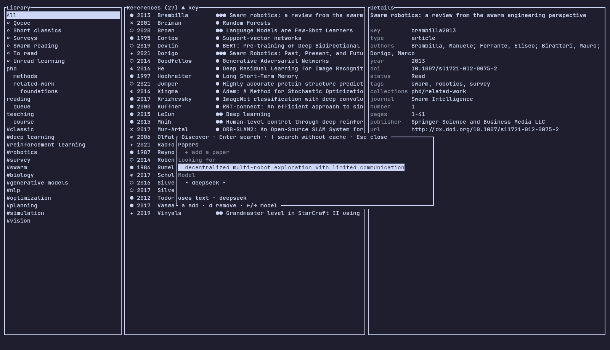
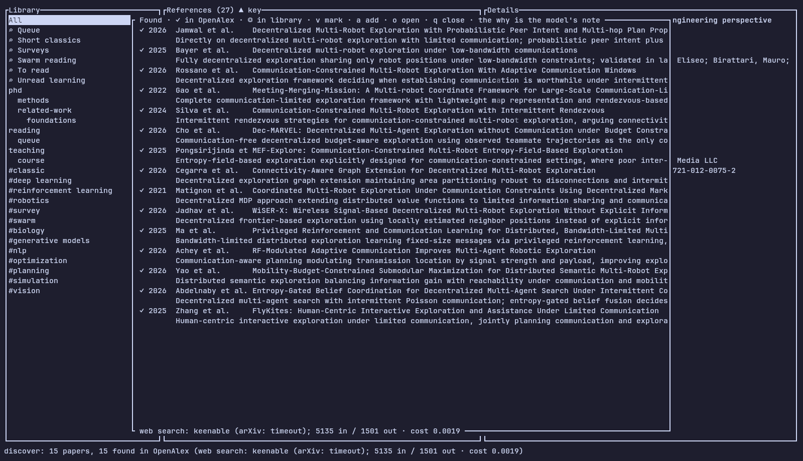
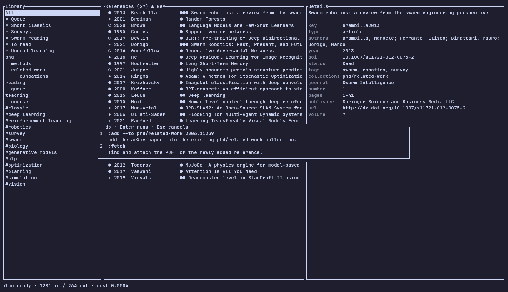
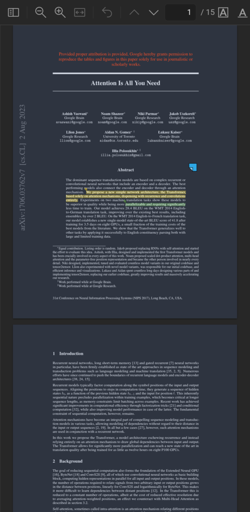

# yeda

<!-- The yeda-tui and yeda-android parts are copied from their READMEs by scripts/readme.py; edit those instead. -->
<!-- yeda-tui -->
<p align="center"><b>A terminal reference manager whose library is plain TOML and Markdown in git.</b><br>
Discover new papers · Vim keys · Zotero-compatible PDF annotations · citation graphs · LLM literature tables · Android companion app</p>


yeda is a vibe-coded alternative to Zotero for the terminal. Your library is a folder of plain files that syncs through git or Syncthing; PDFs live in a local folder, on WebDAV or in Dropbox. An Android app reads and annotates the same library.

```sh
cargo install yeda    # or download the binary from the latest release
yeda init             # create a library, or `yeda import` one from Zotero
yeda                  # open it
```

## Read and annotate


A PDF reader based on Zotero's: highlights, underlines, notes, text, image areas and ink, saved in the library next to the paper, so the Android app shows them too. Column mode reads two-column papers one column at a time.

## Follow the citations


`:graph` lays out what the selected papers cite and what cites them, by year, from OpenAlex. Papers outside the library can be added from it. `:graph tags` and `:graph col <column>` cluster papers by tags or by a table column.

## Compare papers in a table


One row per paper, one column per question, filled in by an LLM (`:summarize`). The LLM reuses values other papers already have, so a column like `group` sorts papers into shared topics. Tables export to CSV (`:export`) and import back (`yeda import-table`).

## Discover papers




`:discover` searches the web and arXiv for papers matching a description or similar to the marked ones. Review the model's relevance notes and add the papers you want to keep.

## Ask in plain words


`:do` turns a request like "add arXiv 2006.11239 to phd/related-work and fetch its PDF" into yeda commands. You approve the plan before it runs, and one undo takes all of it back.

## And more

- **Collect:** by DOI, arXiv ID or ISBN (`:add`), by hand (`:new`), or from Zotero with annotations, notes, tag colours and saved searches (`yeda import`).
- **Organize:** collections, tags, reading status, search and saved searches.
- **Fetch:** PDFs from open access or through your library's proxy (`:fetch`).
- **Cite:** BibTeX or a citation style (`:cite`).
- **Sync:** the library through git (`:sync`).
- **Script:** most commands run without the TUI and pipe keys: `yeda search coll:thesis | yeda cite - --format apa`.

Every action is a command with a rebindable key: [keys and commands](yeda-tui/KEYS.md), [the reader's keys](yeda-tui/../yeda-reader/KEYS.md). Inside yeda, `?` lists them and `:help` is the guide. LLM providers, secrets, PDF locations and the library format are in [CONFIG.md](yeda-tui/../CONFIG.md).

## Requirements
yeda runs on Linux only; macOS and Windows have no secret store backend yet ([#292](https://github.com/yuvve/yeda/issues/292)).

- To build: Rust and [Tauri's prerequisites](https://v2.tauri.app/start/prerequisites/).
- To run: WebKitGTK 4.1 (the reader), poppler (full-text search, annotation extraction, summaries), git (sync), a Secret Service provider such as GNOME Keyring, KWallet or KeePassXC (passwords and API keys), and glibc 2.34 or later for the release binary.
<!-- /yeda-tui -->

## Android app

<!-- yeda-android -->
The Android app is for reading and annotating your library on a phone or tablet. Adding references, citation graphs, literature tables, finding PDFs and citing stay in the terminal app. The interface is high-contrast and has no animations, so it suits e-ink screens.

<p>
  
  
  
  
</p>

Install the APK from the [latest release](https://github.com/yuvve/yeda/releases/latest). Pre-releases are betas.

### Getting started

On first start, pick the library folder and allow all-files access. Get a library onto the device by syncing its folder with Syncthing, or by cloning its git repository from the settings. When a PDF location's folder isn't found on the device, the app asks for it once.

### Features

- **Browse:** filter by collection, tag or saved search; search with the terminal app's syntax; sort.
- **Paper page:** open or add PDFs, preview annotations, edit the Markdown note, change status, tags and collection.
- **Reader:** the same as on the desktop, with Zotero-compatible annotations, column mode and a pen mode (the pen draws, a finger pans, a palm is ignored). An e-ink mode (Settings → Display → E-ink screen) shows one page at a time, turned by swiping, with black ink.
- **Open with:** PDFs from outside the library open with their annotations in a `<file>.annotations/` folder.
- **Sync:** commits, merges `origin` and pushes over HTTPS. Conflicting annotation files are merged annotation by annotation; any other conflict stops the sync.
- **PDFs:** from local folders, WebDAV or Dropbox. Passwords and tokens are kept in the Android Keystore. Settings has the form that adds a storage location.

The app icon is from Flaticon: [Knowledge graph icons created by Jagat Icon - Flaticon](https://www.flaticon.com/free-icons/knowledge-graph).
<!-- /yeda-android -->

## Building

```sh
git clone --recursive <this repo>
cargo install --path yeda-tui      # the `yeda` binary, with the reader built in
```

`scripts/test-library.sh` copies `testdata/library`, a library of real papers, to a scratch folder and fetches its open-access PDFs, for trying changes without touching your own library.
