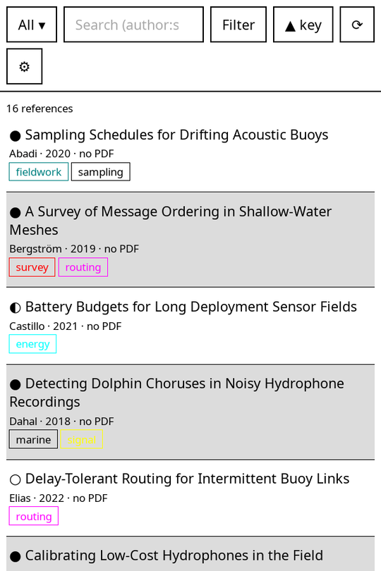
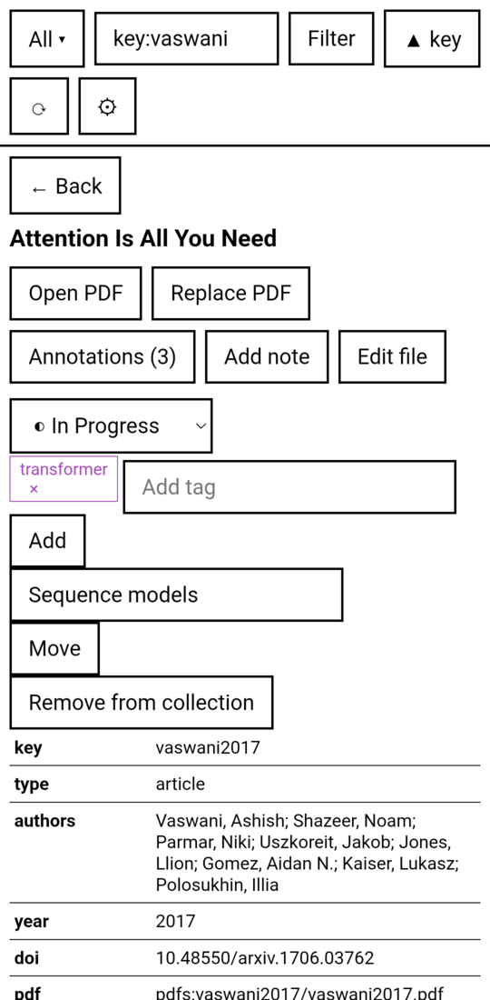
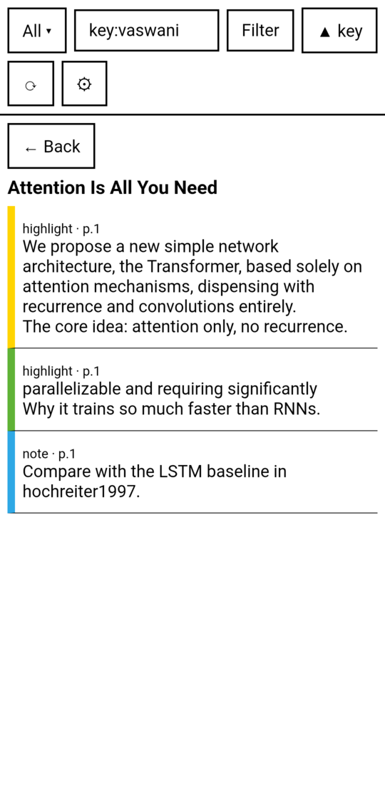
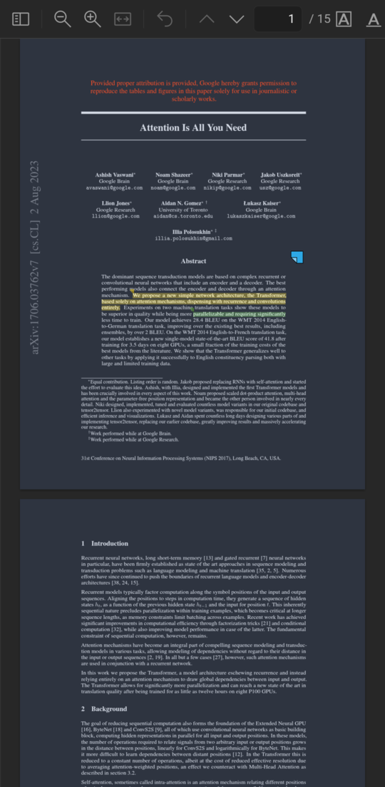

# yeda-android

<!-- embed -->
The Android app is for reading and annotating your library on a phone or tablet. Adding references, citation graphs, literature tables, finding PDFs and citing stay in the terminal app. The interface is high-contrast and has no animations, so it suits e-ink screens.

Install the APK from the [latest release](https://github.com/yuvve/yeda/releases/latest). Pre-releases are betas.

<p>
  
  
  
  
</p>

## Getting started

On first start, pick the library folder with the system folder picker and allow all-files access. To get a library onto the device, sync its folder with Syncthing, or clone its git repository into an empty folder from the settings. When a PDF location's folder isn't found on the device, the app asks for it once.

## Main window

The list can be filtered by collection, tag or saved search, searched with the same syntax as the terminal app (such as `author:smith tag:ml`, which can be saved), filtered by field with a form and sorted. Alternate rows are shaded so a line is easy to follow across the screen.

A paper's page opens its PDFs or adds one, previews its annotations, edits its Markdown note or its raw file, and changes its reading status, tags and collection.

## Reading and annotating

The reader is the same as on the desktop: a modified version of Zotero's PDF reader, so Zotero annotations show and can be edited. Once a pen has been used, the pen draws and a finger pans (two fingers zoom), a resting palm is ignored, and the pen's side button or eraser end erases. An e-ink mode shows one page at a time, turned by swiping, with black ink. Column mode reads a two-column paper one column at a time, each as wide as the screen; swiping steps down the column and on to the next. The columns' position is set by dragging a crop box and the gutter over the page.

PDFs from outside the library open with "Open with"; their annotations go in a `<file>.annotations/` folder next to the PDF.

## Sync

Sync commits everything, merges `origin`'s branch of the same name and pushes, over HTTPS. Conflicting annotation files are merged annotation by annotation; any other conflict stops the sync.

## Settings

WebDAV folders for PDFs can be added after a test login. Settings can also be edited as text: the library folder, and `[locations]` for folders on this device. Passwords and tokens are kept in the Android Keystore.

The app icon is from Flaticon: [Knowledge graph icons created by Jagat Icon - Flaticon](https://www.flaticon.com/free-icons/knowledge-graph).
<!-- /embed -->

## Building

```sh
npm ci && npm run build:reader -w yeda-reader      # at the repository root
cd yeda-android
npx tauri android build --apk --target aarch64     # needs ANDROID_HOME and NDK_HOME
npm run build && cargo run -p yeda-android         # the same app on the desktop
```

`src-tauri/gen/android` is committed because it is customized. Pushing an `android-v*` tag builds a signed APK and publishes it as a pre-release; a `v*` release includes it too.
