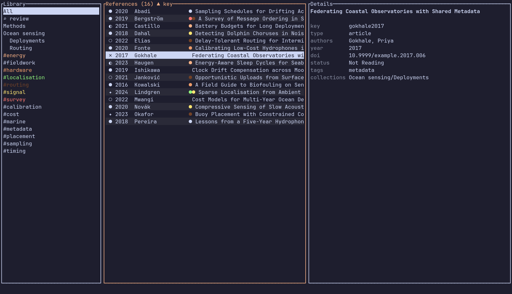
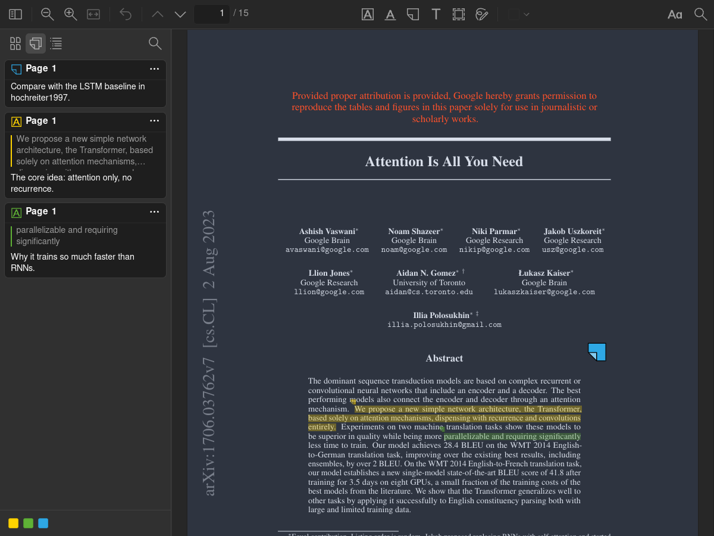
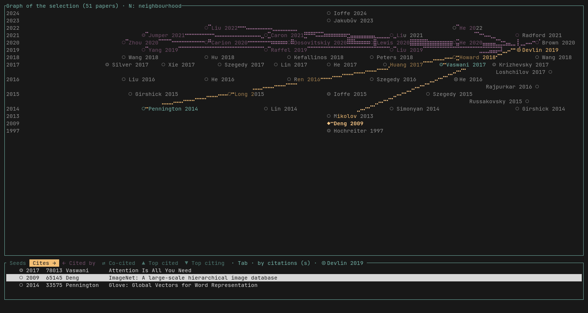
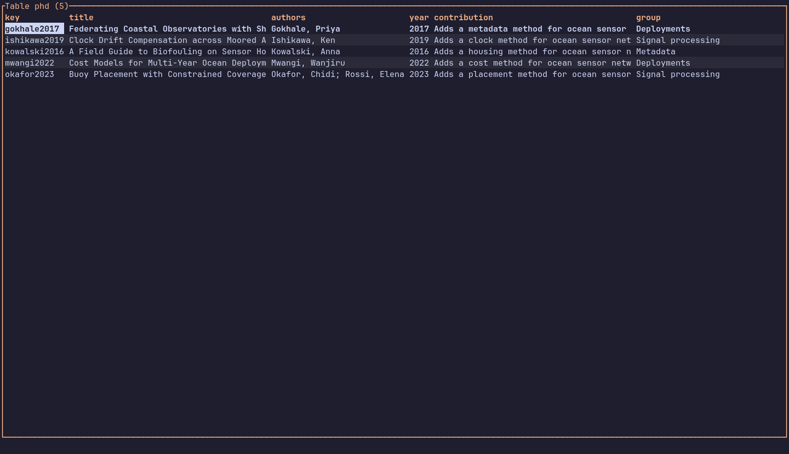

# yeda-tui

<!-- embed -->
**tl;dr:** a (vibe-coded) terminal reference manager whose library you can check into git, with a PDF reader built on Zotero's (so Zotero annotations carry over), citation graphs (including discovery of papers not in the library), a download assistant that makes fetching PDFs easy, LLM features such as paper discovery and summary tables, and an e-ink friendly companion Android app.

**🤖💩 All of yeda's code and documentation is written by AI (Claude). This is 100% vibe-coded 💩🤖**

I used [Zotero](https://www.zotero.org/), but wanted a reference manager in the terminal with vim keys. I tried every terminal reference manager I could find and didn't like any of them. I also really like [Local Citation Network](https://localcitationnetwork.github.io/), and wanted features like it built into my reference manager. So ~~I~~ Claude made yeda.

## About

yeda is a reference manager for the terminal, and an alternative to Zotero. Your library is a folder of plain TOML and Markdown files that works with git and Syncthing; PDFs live in a local folder, on WebDAV, or in Dropbox. An Android app reads and annotates the same library.



- **Collect:** add references by DOI, arXiv ID or ISBN (`:add`), by hand (`:new`), or from Zotero (`yeda import`).
- **Organize:** collections, tags, reading status, search and saved searches.
- **Read:** a PDF reader based on Zotero's, with Zotero-compatible annotations and Markdown notes.
- **Fetch:** find PDFs, open access or through your library's proxy (`:fetch`).
- **Explore:** citation graphs of what a paper cites and what cites it (`:graph`).
- **Compare:** literature tables an LLM fills in (`:summarize`, `:table`).
- **Discover:** related papers from the web and arXiv (`:discover`).
- **Cite:** BibTeX or a citation style (`:cite`).
- **Sync:** the library through git (`:sync`).

## Dependencies

yeda runs on Linux only; macOS and Windows have no secret store backend yet ([#292](https://github.com/yuvve/yeda/issues/292)).

- To build: Rust and [Tauri's prerequisites](https://v2.tauri.app/start/prerequisites/).
- To run: WebKitGTK 4.1 (the reader), poppler (full-text search, annotation extraction, summaries), git (sync), a Secret Service provider such as GNOME Keyring, KWallet or KeePassXC (passwords and API keys), and glibc 2.34 or later for the release binary.

## Usage

```sh
cargo install yeda    # or download the binary from the latest release
yeda init             # create a library
yeda import           # or create it from Zotero
yeda                  # open it
```

`yeda <library dir>` opens a specific library. Without one, yeda opens the current folder if it is a library, else the default library.

`yeda import` takes Zotero's items, annotations, notes, tag colours and saved searches, and copies every PDF to the chosen place. Zotero can stay open; it is only read.

## Keys and commands

Every action is a command with a key, rebindable in `config.toml`. [All keys and commands](KEYS.md), and [the reader's keys](../yeda-reader/KEYS.md). Inside yeda, `?` lists them and `:help` is the guide.

## Reader



Highlights, underlines, notes, text, image areas and ink, saved in the library next to the paper, so the Android app shows them too. Column mode reads two-column papers one column at a time. `reader` in `config.toml` can name another PDF reader, which yeda then sees only through the annotations it saves in the PDF.

## Graphs



`:graph` draws the citation graph of the selected or marked papers by year, from OpenAlex. Papers outside the library can be added from it. `:graph tags` and `:graph col <column>` cluster papers by tags or by a table column.

## LLM features

LLM features use a profile from `yeda.toml`: a provider (where to connect and how to authenticate) and a model. `:setup provider` and `:setup llm` add them.

Any OpenAI-compatible server works (`auth = "api-key"`, or `"none"` for a local one). `auth = "codex"` signs in with a ChatGPT plan and needs no `base_url`. The paper goes to the server as a PDF; a server that refuses it gets the extracted text.

```toml
default_llm = "claude"

[providers.claude]
base_url = "https://api.anthropic.com/v1"
auth = "api-key"

[providers.codex]
auth = "codex"                    # fixes the server

[llm.claude]
provider = "claude"
model = "claude-opus-5-5"
```

### Literature tables

One row per paper, one column per question, filled in by the LLM (`:summarize`). Columns come from `:setup table`; the LLM reuses values other papers already have, so a column like `group` sorts papers into shared topics. Tables export to CSV (`:export`) and import back (`yeda import-table`).



### Finding papers

`:discover` takes a description, or the marked papers as examples, and has the LLM search the web and arXiv and rank the results. Search providers are set with `:setup web-search`.
When opened from the `:setup` menu, Web Search returns to that menu on `Esc` or `q`.

### Running commands from a request

`:do` has the LLM turn a request, such as "add this DOI to a collection called PhD and fetch its pdf", into yeda commands. You approve the plan before it runs, and one undo takes all of it back. A plan can only use `:add`, `:fetch`, `:summarize`, `:discover`, `:search`, `:cache`, `:extract`, `:cite`, `:table`, `:graph`, `:export`, `:save` and `:sync`. The request, the names of collections, tags, tables and locations, and the titles of the marked (else selected) references go to the LLM server.

## Secrets

Passwords and API keys live in the system secret store (`:secrets`), each tied to its server's address, so a key is only sent to the server it was entered for. Secrets only go to `https://` servers. Environment variables can replace or override the secret store (`:envvars`). A SearXNG instance behind basic auth takes its user name and password through `:setup web-search searxng`, in the secret store, never in the URL.

## Scripting

Most commands also run without the TUI. A subcommand takes references by key (or `-` for keys from stdin) and prints keys or tab-separated lines (`--json` gives more):

```sh
yeda search tag:review --sort -year               # key, year, authors, title
yeda search coll:thesis | yeda cite - --format apa
yeda add 10.1038/nature14539 --to thesis
yeda graph lecun2015 > graph.json
yeda discover "swarm exploration under comms loss" --json   # queries and notes go to stderr
```
<!-- /embed -->
